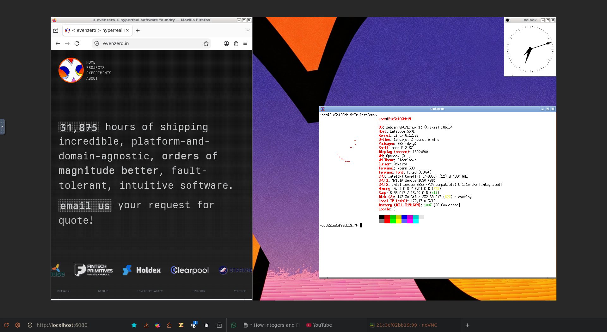

# x11-canvas

Linux GUI in a browser URL using `Xvfb → x11vnc → websockify → <canvas>`



## Quick start

```bash
docker build -t x11-canvas:local .
docker run --rm -d --name canvas -p 6080:6080 x11-canvas:local
open http://localhost:6080/?autoconnect=true      # you should see a clock
```

Point it at your program instead:

```bash
docker run --rm -d -p 6080:6080 \
  -e APP='xterm -e top' \
  -e SCREEN=1000x640x24 \
  -e VNC_WINDOW=xterm \
  x11-canvas:local
```

Check it from the inside, which is also the check to run after you refactor:

```bash
docker exec canvas x11-canvas-smoke      # 6 assertions incl. a real WS handshake
docker exec canvas x11-canvas-selftest   # 9 scenarios, ~40s, needs no other tooling
```

## What the browser path actually is

| stage | process                                                                     | does                                                                                                                                   |
| ----- | --------------------------------------------------------------------------- | -------------------------------------------------------------------------------------------------------------------------------------- |
| 1     | `Xvfb :99 -screen 0 $SCREEN -nolisten tcp`                                  | an X server with no hardware behind it. `$SCREEN` **is** the viewport you see                                                          |
| 2     | `openbox`                                                                   | window manager: reparents, decorates, focuses. `WM=none` skips it                                                                      |
| 3     | your `APP`                                                                  | anything that opens a window                                                                                                           |
| 4     | `x11vnc -display :99 -forever -shared -rfbport $VNC_PORT`                   | exports the live framebuffer as RFB/VNC. `-forever` so a disconnect doesn't end the container; `-shared` so a second viewer can attach |
| 5     | `websockify --web /usr/share/novnc $WEB_BIND:$WEB_PORT localhost:$VNC_PORT` | one port serving both the noVNC static JS and the WebSocket↔TCP tunnel                                                                 |

Input is the same path backwards: noVNC turns your mouse/keys into RFB messages,
x11vnc injects them into X. Nothing here knows what app it is carrying.

## Configuration

Everything is an env var; there are no CLI flags and no config files.

| var                              | default                           | notes                                                                                                 |
| -------------------------------- | --------------------------------- | ----------------------------------------------------------------------------------------------------- |
| `APP`                            | `xclock -update 1`                | shell command line, or `none` for an empty desktop. Exit behaviour below                              |
| `SCREEN`                         | `1600x900x24`                     | WxHxDEPTH. The browser viewport, _not_ the app's size                                                 |
| `WM`                             | `openbox`                         | `none` for the 3-stage minimal chain                                                                  |
| `DISPLAY`                        | `:99`                             | set this if you run a second instance on one host                                                     |
| `VNC_PORT` / `WEB_PORT`          | `5900` / `6080`                   | both honoured; `WEB_BIND=0.0.0.0` by default                                                          |
| `VNC_PASSWORD`                   | unset                             | empty ⇒ `x11vnc -nopw`, i.e. **open RFB**. Set it before exposing the port                            |
| `VNC_WINDOW`                     | unset                             | WM_CLASS/WM_NAME regex ⇒ stream only that window (see cropping)                                       |
| `VNC_EXTRA` / `XVFB_EXTRA`       | unset                             | raw flags, e.g. `VNC_EXTRA="-ncache 10"`                                                              |
| `ROOT_COLOR`                     | `#111111`                         | flat root colour via `xsetroot`; used only when `WALLPAPER` is empty/fails                            |
| `WALLPAPER`                      | `/usr/share/x11-canvas/wallpaper` | image path or `http(s)://` URL set with `feh --bg-fill`; `""` to disable                              |
| `RECORD`                         | unset                             | `FILE` ⇒ `websockify --record`, a replayable session capture                                          |
| `EXIT_ON_APP_EXIT`               | `true`                            | `true`: app exits ⇒ container exits **with the app's status**. `false`: keep serving an empty desktop |
| `READY_TIMEOUT` / `CROP_TIMEOUT` | `30` / `10`                       | per-stage waits                                                                                       |
| `NOVNC_ROOT`                     | `/usr/share/novnc`                | dir containing `vnc.html`                                                                             |
| `RUN_DIR`                        | `/tmp/x11-canvas/$XNUM`           | per-instance `<name>.pid` / `<name>.exit`                                                             |

## Reuse recipes

**Watch a CI run.** `EXIT_ON_APP_EXIT=true` makes the payload's lifetime the
container's, and its exit status becomes the container's:

```bash
docker run --rm -e APP='python3 -m pytest -q tests/test_ui.py' \
           -e SCREEN=1280x800x24 -v "$PWD":/w -w /w x11-canvas:local
echo "suite exit: $?"          # the test result, not 143
```

**Golden-image / visual regression.** A fixed `SCREEN` is a deterministic
display; capture it with `xwd -root` (or `import -window root`) and diff.
`SMOKE_REQUIRE_ANIMATION=true` in `x11-canvas-smoke` shows the frame-diff
technique that proves pixels are actually moving.

**Remote GUI for a heavyweight tool.** EDA, CAD, MATLAB, ROS rviz, a database
client — the container is the thin client. Ship it as `FROM x11-canvas:local`
with `APP=` your binary; see `examples/tkinter` and `examples/firefox`.

**Debug a container that has no UI.** `docker exec` in, `x11-canvas-smoke`, and
you can _look_ at what it is doing rather than reading its stdout.

**Bolt Android back on.** The removed layer was only ever `APP=emulator @avd`
plus `/dev/kvm`. That's the whole interface:

```dockerfile
FROM x11-canvas:local
RUN apt-get -qqy update && apt-get -qqy install --no-install-recommends openjdk-25-jdk xvfb && \
    sdkmanager --licenses && sdkmanager "system-images;android-34;google_apis;x86_64" "emulator"
ENV APP="emulator @avd -gpu swiftshader_indirect -accel on" VNC_WINDOW="Android Emulator"
```

```bash
docker run --device /dev/kvm -p 6080:6080 …
```

## Design notes

- **No supervisor.** Three `supervisord` instances existed only
  to compose screen/port/base bundles; here the same thing is two env vars
  (`WM=none`, `EXIT_ON_APP_EXIT`). PID 1 is a ~180-line bash script whose
  supervision is: wrap each child in a subshell that `wait`s on it, record
  `<name>.pid`/`<name>.exit`, and on a fatal exit `kill -TERM $$`.
- **No `keep_alive()` sleep loop.** Here
  the choice is `EXIT_ON_APP_EXIT`, and the payload's recorded status is
  substituted for our own shutdown status so CI sees the app's code.
- **`setsid` per child + `kill_tree`.** Each child gets its own process group, so
  cleanup can `kill -TERM -- -PID` a whole subtree (reaching `bash -c "a && b"`
  grandchildren) without touching the entrypoint. `kill 0` is _not_ usable: when
  the script is the group leader — which it is, as PID 1 — that signal includes
  itself, and it dies mid-cleanup leaking `websockify`. Escalation to `KILL` is
  also mandatory, not politeness: **websockify does not exit on SIGTERM.**
- **`RUN_DIR` keyed by display number.** A shared `/tmp/x11-canvas` makes two
  instances on one host overwrite each other's pidfiles, after which cleanup can
  only kill the newest one's children.
- **`websockify` called directly, not via `novnc_proxy`.** noVNC's wrapper honours
  only `--listen` and discards a trailing positional port. Selftest scenario 3 fails if that
  bug class ever reappears here.
- **`index.html` ships as a real copy of `vnc.html`.** Without it, `http://host:6080/`
  returns a directory listing (the old symlink was created at runtime in a
  root-owned directory, so it never existed) and only `/vnc.html` works.
- **Cropping is by geometry area, not visibility.** `xdotool --onlyvisible` and
  `xwininfo -id → Map State` both report a reparented app's client window as
  unmapped while it is plainly on screen, which silently disables the crop. The
  selftest asserts the real outcome instead: x11vnc's framebuffer stride drops
  from 6400 B/line (1600px) to 656 (the 164px xclock).
- **`x11vnc -rfbport` is set explicitly**, because the VNC port is otherwise the
  default 5900 regardless of `VNC_PORT`.

## Security, stated plainly

Open RFB by default: anyone who can reach `VNC_PORT`/`WEB_PORT` controls whatever
`APP` is running, with no password and no TLS. `-nopw` is deliberate (a CI job on
a private network should not need a secret to be observable), but if the port
leaves that network, set `VNC_PASSWORD`, publish only `WEB_PORT`, and put TLS in
front of it (a reverse proxy, or `novnc_proxy --cert` instead of raw websockify).

## What is verified, and what is not

Verified by `x11-canvas-selftest` on Debian 13 with the real `Xvfb`, `openbox`,
`x11vnc`, `websockify` and noVNC binaries — **36 assertions, 0 failures**:
geometry, mapped window, RFB banner, HTTP 200 on `/` and `/vnc.html`, a genuine
WebSocket upgrade returning the banner tunnelled _through_ the proxy, frame-diff
liveness, `WM=none`, custom-port-not-added, crop-by-stride, both
`EXIT_ON_APP_EXIT` modes with status propagation, `VNC_PASSWORD` advertising
RFB security type 2, `RECORD` wired, `FATAL` on bad config, lock cleanup on
SIGTERM, and per-scenario child-leak checks over 48 tracked pids.

**Not verified here: the `docker build` itself** — no docker and no `/dev/kvm`
in this environment. The Dockerfile's package list is exactly the set the
selftest ran against, but treat the image build as the one step you must run.
Two assumptions to expect in that step: the `novnc` + `python3-websockify`
package names (Ubuntu/Debian share them; the layout `/usr/share/novnc/vnc.html`
is what the smoke test checks, and `NOVNC_ROOT` is the escape hatch), and
`ubuntu:26.04` as base (any Ubuntu/Debian with those two packages works).
